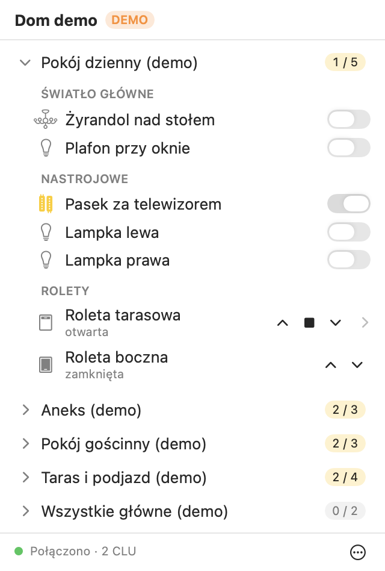
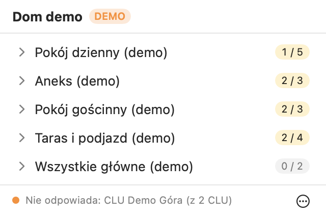
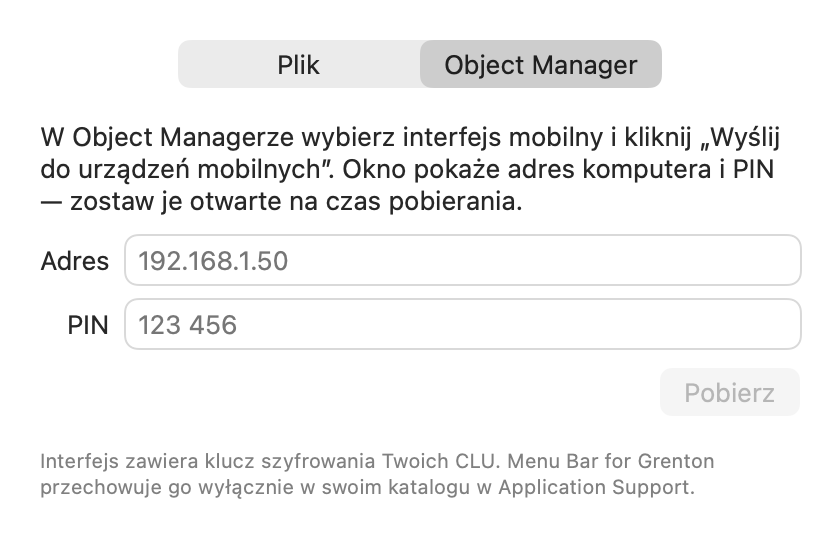

<div align="center">

# 💡 Menu Bar for Grenton

**Your Grenton smart home, one click away in the macOS menu bar.**

Switch lights and move roller shutters without reaching for your phone.

[](#requirements)
[](https://swift.org)
[](https://developer.apple.com/xcode/swiftui/)
[](https://github.com/osieckiAdam/menu-bar-for-grenton/releases/latest)
[](LICENSE)



</div>

## What it is

Menu Bar for Grenton is a small, native and **unofficial** menu bar app for homes running the
[Grenton](https://www.grenton.com) smart home system. It reads the same
mobile interface you use in myGrenton and shows it as a compact list:
**page → section → device**. Click the bulb in the menu bar and your whole
house is right there.

It is also the first real-world client of
[grenton-core-swift](https://github.com/osieckiAdam/grenton-core-swift), a
Swift library for talking to Grenton CLU controllers.

## Features

- **Lights** – switches with a lamp icon, dimmers and RGB lights, each with a toggle.
- **Roller shutters** (`ROLLER_SHUTTER_V3`) – raise, stop and lower; click a row to set the slat angle with a slider.
- **Same layout as myGrenton** – pages, section headers and icons come straight from your mobile interface. Each page shows how many lights are on (`2 / 5`).
- **Live state** – changes made with wall switches show up immediately.
- **Connection status at a glance** – a coloured dot in the menu, and a crossed-out bulb in the menu bar when a CLU stops answering.
- **Local only** – talks to your CLUs over the home network. No cloud, no account, no telemetry.

<table>
  <tr>
    <td align="center" width="50%">
      <br>
      <sub>One CLU down: the rest of the house keeps working</sub>
    </td>
    <td align="center" width="50%">
      <br>
      <sub>Importing the interface straight from Object Manager</sub>
    </td>
  </tr>
</table>

> [!NOTE]
> The user interface is currently in **Polish** only.

## Requirements

- macOS 14 Sonoma or later (Apple silicon or Intel)
- A Grenton installation with a **mobile interface** set up in Object Manager
- A Mac on the same local network as your CLUs
- To build from source: Xcode 26.2 or later (Swift 6.2)

## Installation

### Option A: download a release

1. Download `MenuBarForGrenton-<version>.zip` from the
   [latest release](https://github.com/osieckiAdam/menu-bar-for-grenton/releases/latest).
2. Unzip it and move **Menu Bar for Grenton.app** to your *Applications* folder.
3. Open it. macOS will refuse, saying it cannot verify the developer – see below.

> [!IMPORTANT]
> **Releases are not notarized by Apple.** Menu Bar for Grenton is a free hobby project
> and is not signed with a paid Apple Developer ID, so Gatekeeper blocks it on
> first launch. The app is built from this repository by
> [GitHub Actions](.github/workflows/release.yml); if you prefer not to trust
> a prebuilt binary, [build it yourself](#option-b-build-from-source).

**Optional: check that the zip really comes from this repository.** Each
release has a build provenance attestation and a SHA-256 file. With the
[GitHub CLI](https://cli.github.com):

```bash
gh attestation verify MenuBarForGrenton-<version>.zip --repo osieckiAdam/menu-bar-for-grenton
```

Or compare the checksum with the `.sha256` file from the release:
`shasum -a 256 -c MenuBarForGrenton-<version>.zip.sha256`.

**To open it the first time**, after macOS has blocked it once:

1. Open *System Settings → Privacy & Security*.
2. Scroll down to the message about Menu Bar for Grenton and click **Open Anyway**.
3. Confirm with your password, then click **Open**.

Or, from the Terminal:

```bash
xattr -dr com.apple.quarantine "/Applications/Menu Bar for Grenton.app"
```

You only need to do this once per version. To update, quit the app, replace
the app in *Applications* with the new one and repeat the steps above. macOS
may also ask again for local network access after an update.

### Option B: build from source

1. Clone and open the project – Xcode resolves the `grenton-core-swift`
   package on first open:
   ```bash
   git clone https://github.com/osieckiAdam/menu-bar-for-grenton.git
   cd menu-bar-for-grenton
   open MenuBarForGrenton.xcodeproj
   ```
2. Select the **MenuBarForGrenton** target → *Signing & Capabilities* and choose your
   own team (a free Apple ID works).
3. Run (⌘R).

To get a standalone app instead of running from Xcode, build the same zip the
releases use – it ends up in `dist/`:

```bash
scripts/build-release.sh 0.1.0
```

**Demo mode (no hardware needed).** In *Product → Scheme → Edit Scheme… →
Run → Arguments*, tick `-DemoMode YES` and run. The menu shows a
synthetic house backed by a simulated Grenton system; the **⋯** menu lets you
flip a light “from a wall switch” or simulate a CLU failure.

## Connecting your home

On first launch the **import window** opens. Pick one of:

| Source | How |
| --- | --- |
| **Object Manager** (recommended) | In Object Manager select your mobile interface and click *Send to mobile devices*. It shows your computer’s address and a PIN – enter both in the app and click *Pobierz* (Download). Keep the Object Manager window open until it finishes. |
| **Interface archive** (`.zip`) | The interface archive exported from Object Manager. |
| **Project file** (`.omp`) | Your Object Manager project. If it has several mobile interfaces, you pick one. |

The first time the app connects, macOS asks for permission to access
devices on your local network – click **Allow**. If you missed it, enable
Menu Bar for Grenton in *System Settings → Privacy & Security → Local Network* (the
app links there when no CLU answers).

You can switch to a different interface at any time from the **⋯** menu.

The connection to your CLUs starts the first time you open the menu and
stays up until you quit the app, so state is always current when you look.

## Security and privacy

The mobile interface contains the **AES key of your CLUs**. The app
never stores it on its own: the interface is kept only by the library’s
`InterfaceStore`, inside the app’s sandboxed Application Support folder:

```
~/Library/Containers/com.osieckiadam.MenuBarForGrenton/Data/Library/Application Support/com.osieckiadam.MenuBarForGrenton/Grenton/
```

To delete it, choose **⋯ → Usuń zapisany interfejs…** (Remove saved
interface). Do this before deleting the app: removing the app from
*Applications* leaves its data behind.

- `*.zip` and `*.omp` are git-ignored. **Never commit your interface or project file.**
- The repository contains only synthetic interfaces
  ([demo](MenuBarForGrenton/Demo/demo-interface.json),
  [tests](MenuBarForGrentonTests/Fixtures/test-interface.json)).
- The app talks only to the CLUs and the Object Manager address you enter.
- Diagnostic messages in the system log (Console.app, subsystem
  `com.osieckiadam.MenuBarForGrenton`) are marked private, so CLU names and
  addresses do not show up in log captures attached to bug reports.

## Contributing

Contributions are welcome – bug reports, ideas and pull requests alike.

1. **Open an issue first** for anything larger than a small fix, so we can agree on the approach.
2. Fork the repo and create a branch from `main`.
3. Make your change and keep the tests green.
4. Open a pull request describing *what* changed and *why*. Screenshots help for UI changes.

### Project layout

```
MenuBarForGrenton/
├── MenuBarForGrentonApp.swift  # App entry, menu bar icon
├── AppModel.swift              # App state: interface, connection, demo
├── Model/                      # Home, pages, lights, shutters, connection status
├── Views/                      # Menu, page list, footer
├── Import/                     # Import window (.zip, .omp, Object Manager)
└── Demo/                       # Simulated house for demo mode
MenuBarForGrentonTests/         # Unit tests and screenshot rendering
scripts/build-release.sh        # Release build: ad-hoc signed, zipped
scripts/release.sh              # Test, tag, publish and verify a release
.github/workflows/              # Publishes a release when a version tag is pushed
```

### Development tips

- **Xcode project** – generated by [XcodeGen](https://github.com/yonaskolb/XcodeGen)
  from [`project.yml`](project.yml). After adding or removing files run:
  ```bash
  xcodegen generate
  ```
- **Tests** – run without network or hardware:
  ```bash
  xcodebuild test -scheme MenuBarForGrenton -destination 'platform=macOS'
  ```
- **Screenshots without clicking the menu bar** – render the menu and the
  import window to PNG (this is how the images above were made). The test
  host is sandboxed, so build unsigned to write outside its container:
  ```bash
  TEST_RUNNER_SNAPSHOT_DIR=$PWD/docs/images xcodebuild test \
    -scheme MenuBarForGrenton -destination 'platform=macOS' \
    -only-testing:MenuBarForGrentonTests/Snapshots CODE_SIGNING_ALLOWED=NO
  ```
- **Library issues** – anything that belongs in grenton-core-swift is
  tracked in [NOTES.md](NOTES.md) (in Polish) and fixed upstream rather than
  worked around silently.
- **Style** – follow the surrounding code: Swift 6 strict concurrency,
  SwiftUI with `@Observable` models, short doc comments explaining *why*.

### Releasing

Run [`scripts/release.sh`](scripts/release.sh) from an up-to-date, clean `main`:

```bash
scripts/release.sh 0.2.0
```

It runs the tests and a local release build, pushes the `v0.2.0` tag, waits
for the [Release workflow](.github/workflows/release.yml) and verifies the
`MenuBarForGrenton-<version>.zip` it attaches to a new GitHub release. The
version shown in the app comes from the tag. Builds are ad-hoc signed and not
notarized, so no Apple Developer account is involved.

If the workflow fails, fix it on `main` and release the next patch version;
never move a published tag.

## License

Menu Bar for Grenton is released under the [MIT License](LICENSE).

---

<sub>Menu Bar for Grenton is an independent, community project and is not affiliated
with, endorsed by, or supported by Grenton Sp. z o.o. “Grenton”,
“myGrenton” and “Object Manager” are names of their respective owners.</sub>
